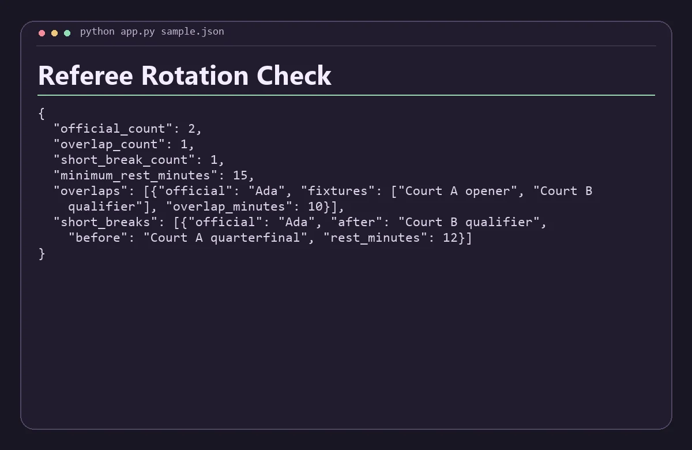

# Referee Rotation Check

Audit a one-day officiating schedule for overlapping fixtures and breaks shorter than a rest window you set.



## Run

Install Python 3.11 or newer. Run these commands from the repository root.

```sh
python app.py sample.json
```

Replace `sample.json` with a JSON file following the same structure. The app prints a JSON report to standard output.

Enter each assignment using a consistent official label, a fixture name, and same-day 24-hour times. Use `24:00` to end a fixture at midnight. The audit reports every overlapping pair for the same official and checks rest between consecutive occupied intervals. A fixture starting exactly at the previous end has zero minutes of rest.

## Verify

Run `python check.py` with Python 3.11 or newer after the build step when applicable. The check verifies the bundled scenario and confirms that an invalid input returns an error.
